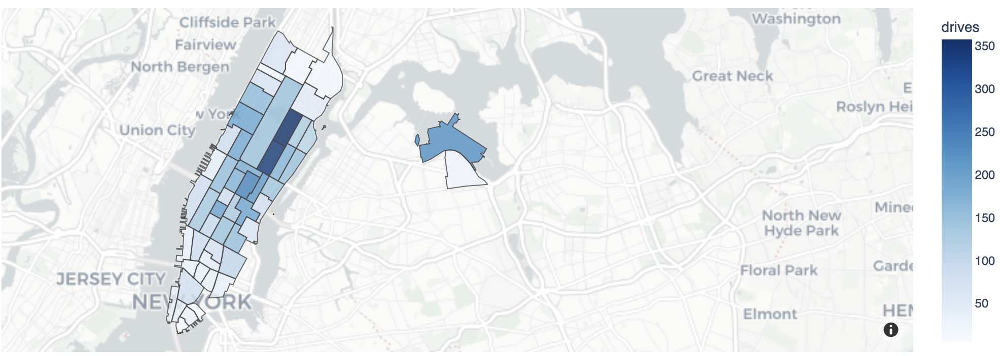
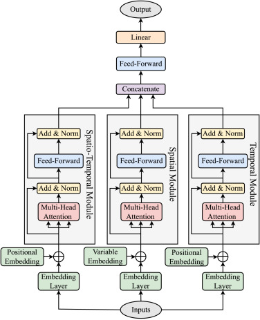
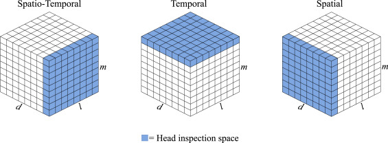
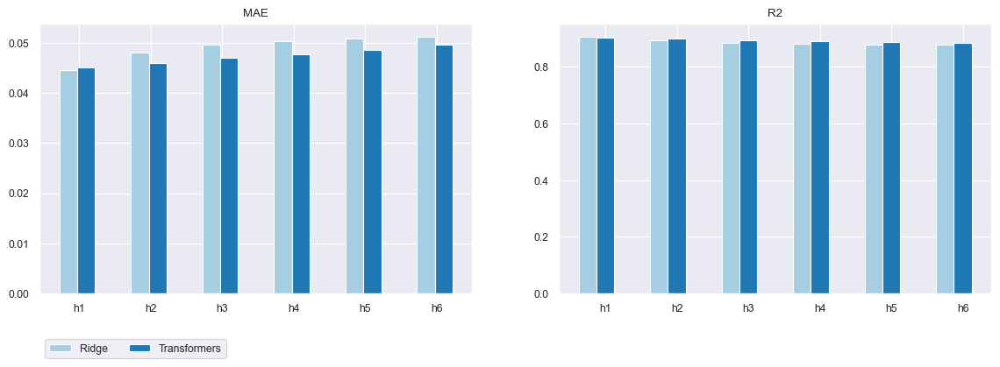
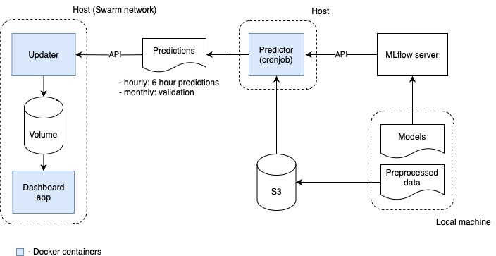

# Multivariate Short-Term Taxi-Demand Forecasting

An end-to-end personal project for six-hour-ahead demand forecasting across New York City taxi zones. The project had two goals:

1. Explore whether a spatio-temporal transformer could learn relationships between multiple regional demand series.
2. Build a complete ML service and gain practical experience with deployment and MLOps.

**Stack:** scikit-learn, PyTorch, FastAPI, MLflow, Docker, Docker Swarm, and GitLab CI/CD.

## Problem statement

Predict hourly yellow-taxi demand in each selected New York City zone over a six-hour horizon.

The project uses [TLC Trip Record Data](https://www.nyc.gov/site/tlc/about/tlc-trip-record-data.page). Of more than 250 zones, 55 with average demand above five trips per hour were selected.

The experiments intentionally use only the original trip data. External predictors such as weather forecasts were excluded so that the comparison focused on model architecture.

## Baseline (2020)

Several classical approaches were tested, including ARIMA models for clusters of related series and regression models. The final baseline uses six ridge-regression models, one for each forecast horizon, together with feature engineering based on:

- Fourier harmonics for daily and weekly seasonality;
- interactions between common features, zone identifiers, and forecast hours;
- autoregressive demand values and recent trip statistics such as distance, cost, and journey time.

Depending on the forecast horizon, the baseline achieved:

- normalised MAE between 0.04457 and 0.05129;
- $R^2$ between 0.90793 and 0.87887.

## Spatio-temporal transformer (2023)

The model adapts the architecture proposed in [STTRE: A Spatio-Temporal Transformer with Relative Embeddings for Multivariate Time-Series Forecasting](https://www.sciencedirect.com/science/article/pii/S0893608023005361).

The central idea is to use separate embedding mechanisms to learn temporal and cross-zone relationships:

The original architecture was modified in two main ways:

1. The embedding transformation was extended from $\mathbb{R} \to \mathbb{R}^d$ to $\mathbb{R}^k \to \mathbb{R}^d$ so that each observation could include additional trip information.
2. The regression head was changed from single-value prediction to joint prediction across all zones and six forecast hours, with recent weekly demand added to the transformer output.

The transformer slightly outperformed the ridge baseline for forecast horizons longer than one hour:

The experiments suggested that cross-zone information can add value, but also showed the limits of the available data. Older observations introduced distribution shift, and the smallest tested architecture performed best.

## ML service and deployment

The second part of the project simulated an hourly updated forecasting service:

The implementation included:

- a containerised scheduled inference job;
- a small API-based service architecture;
- MLflow model and artifact tracking;
- Docker Swarm orchestration;
- a local Docker registry;
- GitLab CI/CD.

A former colleague contributed the front-end design of the Plotly dashboard. The original demonstration deployment is currently offline.
